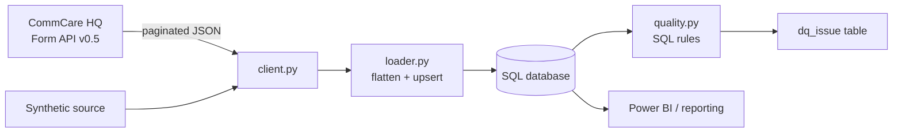

# CommCare to SQL Data Pipeline (prototype)

A small, tested pipeline that pulls submitted forms from the **CommCare HQ Form API**, loads them idempotently into a SQL database, and runs **data quality checks** on the result. It is a personal learning project that models the workflow behind field data toolkits: collect in CommCare, store in a warehouse, check quality, then report in Power BI.

> **Status:** prototype. It runs end to end on synthetic data and the API client is unit-tested against a mocked HQ response. It has not yet been run against a live CommCare project. All data is synthetic.

## Architecture



## Quick start

```powershell
pip install -r requirements.txt
$env:PYTHONPATH = "src"
python -m commcare_pipeline.cli --source synthetic --db pipeline.db
python -m unittest discover -s tests -v
```

To use a real CommCare project, create a free account at commcarehq.org, generate an API key, and set:

```powershell
$env:COMMCARE_DOMAIN="your-project"; $env:COMMCARE_USERNAME="you@example.org"; $env:COMMCARE_API_KEY="..."
python -m commcare_pipeline.cli --source commcare --db pipeline.db
```

## Design decisions

- **Idempotent loads:** rows are upserted by `form_id`, so re-running a sync never duplicates data, including duplicate submissions.
- **Incremental sync:** the last `received_on` is stored in `sync_state` and passed to the next API call.
- **Rules as SQL:** each data quality rule is one query, so analysts can read and extend them. Findings go to `dq_issue` for dashboarding.
- **Secrets from the environment:** API keys are never committed.
- **Portable SQL:** the prototype uses SQLite for zero-setup runs. Types and statements map to SQL Server or Azure SQL, with `MERGE` replacing `ON CONFLICT`.

## Documentation

- [Data dictionary](docs/data-dictionary.md)
- [User stories and acceptance criteria](docs/user-stories.md)

## Roadmap

- Run against a live CommCare project and add case-data export.
- Azure SQL target and a scheduled run via GitHub Actions.
- Power BI report over `household_visit` and `dq_issue`.
- Data quality rule versioning and alert thresholds.
